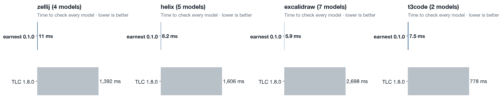

# earnest

A model checker for models written in your app's own language.

Write the rules of a feature as an ordinary TypeScript or Rust file. `earnest verify` visits every reachable state in milliseconds, prints the shortest path to each broken rule or stuck state, and exports to TLA+ so TLC can confirm its verdicts.


**[Read the docs](https://earnest.cpeaustriajc.dev)** · **[Quickstart](https://earnest.cpeaustriajc.dev/start/quickstart/)** · **[Agent prompt](https://earnest.cpeaustriajc.dev/prompt.md)** · **[`llms.txt`](https://earnest.cpeaustriajc.dev/llms.txt)** · **[Changelog](https://earnest.cpeaustriajc.dev/changelog/)**

> [!WARNING]
> **Early access.** There is no release yet and nothing is on npm or crates.io. Only nightly builds of `main` ship today, and the model API and CLI can change between nights. Earnest 0.1.0 passes its own checks and TLC 1.8.0 confirms every conformance model in CI, but adversarial passes have still found missed bugs, so treat it as unproven.

## Install

Install the nightly build of `main`:

```sh
# macOS and Linux
curl -fsSL https://raw.githubusercontent.com/cpeaustriajc/earnest/main/install.sh | sh

# Windows (PowerShell)
irm https://raw.githubusercontent.com/cpeaustriajc/earnest/main/install.ps1 | iex
```

Or build from source with Cargo:

```sh
cargo install --git https://github.com/cpeaustriajc/earnest earnest-cli
```

You don't need to write models by hand. Paste the prompt from [Quickstart](https://earnest.cpeaustriajc.dev/start/quickstart/) (or [`/prompt.md`](https://earnest.cpeaustriajc.dev/prompt.md)) into a coding agent and it installs `earnest`, models your code, and reports broken rules with their shortest path. Agents reading docs directly can load focused bundles from [`/llms.txt`](https://earnest.cpeaustriajc.dev/llms.txt) ([TypeScript](https://earnest.cpeaustriajc.dev/_llms-txt/typescript-models.txt), [Rust](https://earnest.cpeaustriajc.dev/_llms-txt/rust-models.txt)).

See the [Install guide](https://earnest.cpeaustriajc.dev/start/install/) for manual SHA-256 verification and setting up `@earnestjs/model` or the `earnest` Rust crate.

## Example

Write a model in TypeScript (`src/turnstile.model.ts`) where `push` forgets to check `paid`:

```ts
import { m } from "@earnestjs/model";

export const Turnstile = m.model("Turnstile", {
	gate: m.enum(["locked", "open"]).initial("locked"),
	paid: m.boolean().initial(false),
	visitors: m.int(0, 3).initial(0),
});

export const pay = m.action(Turnstile, "the visitor pays", {
	when: (s) => !s.paid,
	changes: () => ({ paid: true }),
});

export const push = m.action(Turnstile, "the visitor pushes", {
	when: (s) => s.visitors < 3,
	changes: (s) => ({ gate: "open", visitors: s.visitors + 1 }),
});

export const staysLocked = m.rule(
	Turnstile,
	"The gate stays locked until the visitor pays",
	(s) => s.gate === "locked" || s.paid,
);

export const full = m.end(Turnstile, "Three visitors went through", (s) => s.visitors === 3);
```

Run `earnest verify`:

```text
fail        Turnstile  8 states  0 ms
  broken  staysLocked  "The gate stays locked until the visitor pays"
    start  gate = "locked", paid = false, visitors = 0
    1. push  gate: "locked" -> "open", visitors: 0 -> 1
    end    gate = "open", paid = false, visitors = 1
1 model: 0 pass, 1 fail, 0 unfinished
```

See [Write a model in Rust](https://earnest.cpeaustriajc.dev/tutorials/rust-model/) for the same model written as a Rust struct.

## Commands

```sh
earnest verify                       # check every model in the repository
earnest verify --json                # machine-readable JSON output
earnest chart src/turnstile.model.ts # print a Mermaid statechart
earnest report --base origin/main    # Markdown PR report with rule diffs
earnest tla src/turnstile.model.ts --out build/tla
earnest confirm --tlc tla2tools.jar  # confirm verdicts with TLC or --tla-rs
```

## Where Earnest fits

Earnest is an **explicit-state model checker**, the same branch of formal verification as TLA+ (TLC) and Quint. Different verification methods check different things:

| Method | Examples | Checks | Coverage | Trade-off |
|---|---|---|---|---|
| Example-based tests | Vitest, `cargo test`, Playwright | Running code | Scripted paths you write | High fidelity; misses unscripted event orderings |
| Property-based / UI fuzzing | Bombadil, `fast-check`, `proptest` | Running code or live UI | Randomly sampled paths and inputs | Tests real code and UIs; cannot prove no other path fails |
| **Explicit-state model checking** | **Earnest**, TLA+ (TLC), Quint | Finite state-machine model | **Every reachable state** in the model | Proves rules across all orderings; model can drift from code |
| Deductive / SMT code proofs | Verus, Kani, Dafny | Implementation code | All inputs, including unbounded | Strongest guarantee on code; highest proof effort |

These methods complement each other. Use Vitest or `cargo test` for concrete behavior, Bombadil or `proptest` to fuzz the running app or UI, and Earnest to check every state transition of a tricky design in milliseconds.

## Compared with TLA+ and Quint

Infrastructure teams (such as AWS) and protocol engineers use TLA+ (with TLC) and Quint to check every reachable state before shipping, but both require a separate specification language and a Java runtime. Earnest keeps models in ordinary TypeScript or Rust, runs as one ~5 MB binary with no Java, and exports to TLA+ so TLC can confirm its verdicts. Earnest checks state rules and stuck states, not "eventually" (temporal) rules, declared witness runs, or parameterized setups; export to TLC when you need temporal rules.

| | earnest 0.1.0 | TLA+ (TLC 1.8.0) | Quint 0.33.1 |
|---|---|---|---|
| Model language | TypeScript or Rust | TLA+ | Quint |
| Runtime and size | ~5 MB binary, no Java | Java + `tla2tools.jar` (~300 MB) | Node + Java + Apalache (~527 MB) |
| Two zellij models | 4.2 ms | 696 ms | 878 ms (`run`) / 5,865 ms (`verify`) |
| Exhaustive rules and stuck states | Yes | Yes | Yes (`verify`); `run` samples |
| "Eventually" (temporal) rules | No (export to TLC; [#21](https://github.com/cpeaustriajc/earnest/issues/21)) | Yes | Yes |
| Witness runs and model parameters | No ([#21](https://github.com/cpeaustriajc/earnest/issues/21)) | Config constants (`.cfg`) | Yes (`quint test`, module params) |

Four coding agents modelled 18 implicit state machines across zellij, helix, excalidraw, and t3code. TLC 1.8.0 confirmed every verdict (18 of 18). Earnest checked all models of each app in **5.9 to 11 ms** (5.2 to 7.1 MB peak memory) compared with **778 to 2,698 ms** (137 to 162 MB) for TLC.



Read the [full comparison](https://earnest.cpeaustriajc.dev/compare/tla/), or inspect the reproducible [benchmarks](tasks/benchmark/README.md) (10 million states in under 5 s and 256 MiB), [conformance suite](tasks/conformance/README.md), and [adversarial tests](tasks/break_it/README.md).

## Requirements and security

- **Platforms:** Prebuilt binaries ship for macOS (Apple silicon, Intel), Linux x64/ARM64 with glibc 2.39 or newer, and Windows x64. Linux with musl builds from source with Cargo.
- **No extra runtime:** `earnest` needs no Java and no Node. Only `earnest confirm --tlc` requires Java and `tla2tools.jar` (`--tla-rs` needs no Java).
- **Static parsing, no code execution:** `earnest` parses TypeScript and Rust files statically. It never executes JavaScript, resolves `node_modules`, or runs `cargo build`.
- **Offline and bounded:** The binary makes no network calls and writes only to `.earnest/` (plus `--out` for `earnest tla`). `--max-states` (default `5000000`) and `--time-limit` cap state count and runtime.
- **Verified downloads:** `install.sh` and `install.ps1` verify the archive's SHA-256 against its `.sha256` file before installing.
- **Licenses:** The checker is `GPL-3.0-or-later` ([LICENSE](LICENSE)). The model libraries (`earnest`, `earnest_macros`, and `@earnestjs/model`) are `LGPL-3.0-or-later` ([LICENSE.LESSER](LICENSE.LESSER)), so app code that depends only on them does not fall under the GPL.

## Documentation

Full documentation lives at [earnest.cpeaustriajc.dev](https://earnest.cpeaustriajc.dev):

| Guide | What it covers |
|---|---|
| [Quickstart](https://earnest.cpeaustriajc.dev/start/quickstart/) & [Install](https://earnest.cpeaustriajc.dev/start/install/) | Agent prompt, nightly installs, source builds, model libraries |
| [Tutorials](https://earnest.cpeaustriajc.dev/tutorials/first-model/) | First TypeScript model, first Rust model, pull request reports and CI |
| [CLI and model discovery](https://earnest.cpeaustriajc.dev/reference/cli/) | Subcommands, flags, workers, caching, exit codes, file discovery |
| [Output, JSON, and reports](https://earnest.cpeaustriajc.dev/reference/output/) | Text output, JSON schema, `--base` rule diffs, charts and reports |
| [TypeScript models](https://earnest.cpeaustriajc.dev/reference/typescript/) | Allowed syntax, views, safe integers, Node `explore` and `replay` |
| [Rust models](https://earnest.cpeaustriajc.dev/reference/rust/) | Attributes, `#[view]`, `Option`, `match`, move rules, `replay`, clippy lints |
| [Primitives and ordering](https://earnest.cpeaustriajc.dev/reference/primitives/) | All built-in types and operations, deterministic set/map walk order |
| [TLA+ export and confirmation](https://earnest.cpeaustriajc.dev/reference/tla/) | Exporting TLA+, running TLC or `tla-rs`, quantifier semantics, TLC limits |
| [Compare with TLA+ and Quint](https://earnest.cpeaustriajc.dev/compare/tla/) | Real-app case studies, benchmarks, and trade-offs |
| [Changelog](https://earnest.cpeaustriajc.dev/changelog/) | Nightly changes, newest first |

## Contributing

See [CONTRIBUTING.md](CONTRIBUTING.md) for the workspace layout, running `just check`, benchmarks, and [writing documentation](contributing/docs-writing.md).
