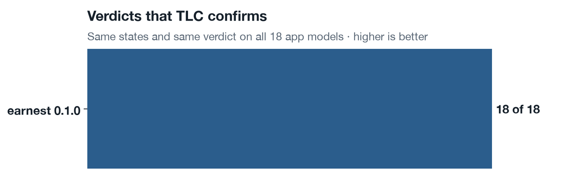
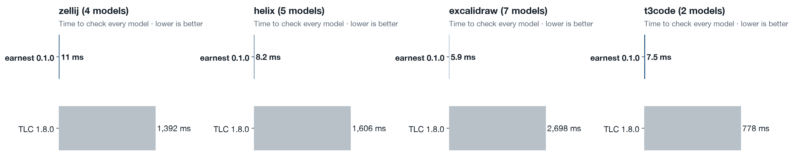
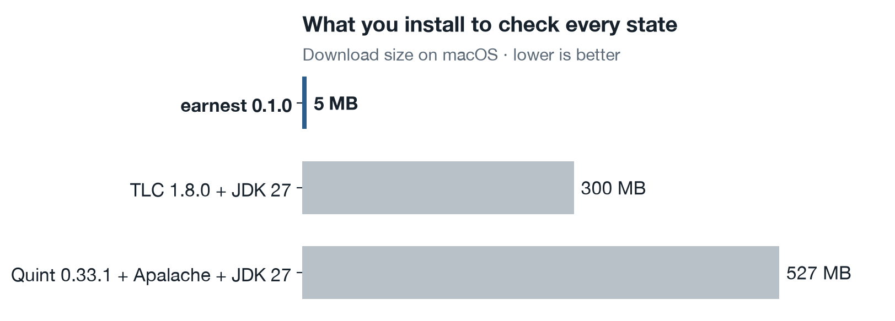

We gave an agent one sentence for each of four open-source apps: "find all implicit state machines to the <app> using `earnest`". Nothing else: no models to start from, no hints about where to look. Each agent cloned the app, read its code, wrote the machines it found as earnest models in the app's own language, and ran `earnest verify`. We then ran TLC on earnest's TLA+ export of every model.

An implicit state machine is a status that many parts of the code change directly, with no one place that says which changes are allowed. For example, zellij stores a tab switch that you press while a new tab loads, and a different function applies it later.

## What the agents found

The models are not in this repository. The table gives the results at each app's named commit.

| App | Language | Commit | Models | Models with a broken rule | Time for the agent |
|---|---|---|---|---|---|
| [zellij](https://github.com/zellij-org/zellij) | Rust | `62cfa6c` | 4 | 4 | 11 min |
| [helix](https://github.com/helix-editor/helix) | Rust | `1a3fdfd` | 5 | 4 | 12 min |
| [excalidraw](https://github.com/excalidraw/excalidraw) | TypeScript | `9c2e462` | 7 | 6 | 15 min |
| [t3code](https://github.com/pingdotgg/t3code) | TypeScript | `9de4ec1` | 2 | 2 | 17 min |

The agents also listed 66 more machines that they didn't model.

Each broken rule comes with the shortest path to it, step by step. We checked these four in the code:

- **zellij, a tab switch goes one tab too far.** While a tab loads, `GoToTab` stores a 1-based index (`screen.rs:13032`). The code that applies it later adds 1 again (`screen.rs:12962`). Path: a new tab starts loading, you press `GoToTab 1`, the tab finishes, and the second tab is active.
- **helix, the register stays in the macro.** Typing `"a` and then `Q` to stop a recording leaves `"a` at the end of the macro, because `record_macro` drops only the last key (`commands.rs:6970`).
- **excalidraw, the crop editor stays open on a deleted image.** Delete never clears `croppingElementId` (`actionDeleteSelected.tsx:300`).
- **t3code, a run that ended starts again.** A `failed` run can go back to `preparing` (`Orchestrator.ts:12762`), while `isTerminalRunStatus` treats `failed` as final (`ThreadManagementService.ts:585`). A failing test in t3code's own test harness shows one effect. A scheduled task fails its worktree setup, the user presses Retry, and the agent starts. The Schedules page still shows the run as Failed, because `ScheduledTaskService.ts:962` writes `failed` once and never looks again.

## Zed: the Git panel can run two commits at once

A fifth agent modelled the Git panel of [Zed](https://github.com/zed-industries/zed) at commit `d31d107`. The model `GitPanelCommit` has 39 states, and `earnest verify` breaks its rule "At most one commit or uncommit runs at a time" in two steps: click **Commit**, then press the Commit key.


The button checks `pending_commit` (`git_panel.rs:7102`), but the Commit key checks only focus (`git_panel.rs:4205`). Then `commit_changes` replaces the pending commit (`git_panel.rs:4429`), so the first task is dropped while its git job still runs. We confirmed this by reading the source. We have not run it in Zed. The Zed model is not one of the 18 in the charts below.

## TLC agrees on every model

TLC 1.8.0 found the same states and the same verdict as earnest on all 18 models.



## Speed, memory and install size

Real app machines are small. The largest of the 18 has 148 states. At that size, most of TLC's time is Java starting up.




We ported the two zellij models to Quint by hand and timed all three tools on them.




The Quint size leaves out Node. `quint verify` downloads Apalache on its first run, because it translates Quint to TLA+ through Apalache.

Method: hyperfine 2.0.0, with 2 warm-up runs and 10 measured runs. The three-tool chart used 1 warm-up run. Every run was on a 10-core Apple silicon Mac. TLC ran on one worker, on earnest's TLA+ export of each model, and its time includes Java starting up.

## The same machine in three tools

This is the zellij tab switch. The rule says that once no tab is loading, the active tab is the one you asked for. All three tools report the same four steps to the bug: a new tab starts, you press `GoToTab 1`, the tab is applied, and the active tab is 1, not 0.

Earnest, in Rust, the language of the app:

```rust
#[action("the user presses GoToTab with a 1-based index")]
fn go_to_tab(&self, #[one_of(1, 2)] index: u8) -> Option<Self> {
	if !self.tab_loading {
		return Some(Self { active_position: index - 1, wanted_position: Some(index - 1), ..self.clone() });
	}
	Some(Self { stored: Some(index), wanted_position: Some(index - 1), ..self.clone() })
}

#[rule("Once no tab is loading, the active tab is the one the user last asked for")]
fn lands_where_asked(&self) -> bool {
	self.tab_loading || self.wanted_position.map_or(true, |wanted| wanted == self.active_position)
}
```

Quint:

```
action go_to_tab(index: int): bool =
	if (not(tab_loading)) all {
		active_position' = index - 1, wanted' = index - 1,
		tab_loading' = tab_loading, loaded_once' = loaded_once, stored' = stored,
	} else all {
		stored' = index, wanted' = index - 1,
		active_position' = active_position, tab_loading' = tab_loading, loaded_once' = loaded_once,
	}

val lands_where_asked = tab_loading or wanted == -1 or wanted == active_position
```

TLA+, written by hand:

```tla
GoToTab(index) ==
	/\ wanted' = index - 1
	/\ IF loading
		THEN stored' = index /\ UNCHANGED active
		ELSE active' = index - 1 /\ UNCHANGED stored
	/\ UNCHANGED <<loading, loadedOnce>>

LandsWhereAsked == loading \/ wanted = None \/ wanted = active
```

The Quint and TLA+ versions must say what every other variable does in each step. The earnest version names only the fields that change, and the app's own type checker reads it.

## What differs

| | earnest | TLA+ with TLC | Quint |
|---|---|---|---|
| Language of the model | TypeScript or Rust, the app's own | TLA+ | Quint |
| Checked with the app's own type checker and linter | Yes | No | No |
| Setup | One binary, no Java, no network | Java and `tla2tools.jar` | Node, plus Java and Apalache for `verify` |
| Checks every state | Yes | Yes | Yes with `verify`. `run` samples paths |
| Checks "eventually" properties | No | Yes | Yes |
| Can export to TLA+ | Yes, and TLC confirms the result | Not applicable | Yes, through Apalache |

Earnest checks rules that must hold in every state, and states where nothing can happen. It can't check that something happens eventually. For example, the t3code agent found that a run can stay `waiting` after 5 failed checkpoint captures, and it couldn't model that one. For that kind of property, export the model and use TLC.

## Limits of this comparison

- An agent wrote every model by reading the code, so a model can be wrong about the app. A broken rule is a lead to check in the code, not proof of a bug.
- "All" means what each agent's search found. Each agent modelled 2 to 7 machines and only listed the rest.
- One t3code bug is reproduced by a failing test. The other bugs, Zed's among them, are confirmed only by reading the source. None of them has been reported to its project.
- The models are not in this repository, so you can't rerun these numbers from it.
- One agent stopped on its first try because "the helix" named no repository. With `helix-editor/helix`, it went ahead.
