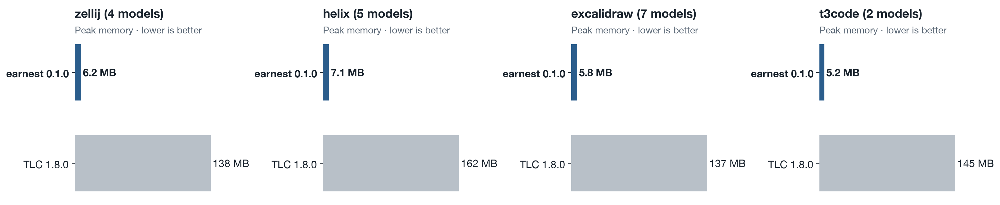
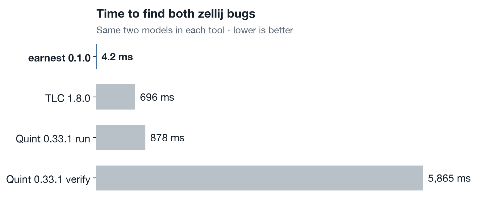

We gave an agent one sentence for each of four open-source apps: "find all implicit state machines to the <app> using `earnest`". Nothing else: no models to start from, no hints about where to look. Each agent cloned the app, read its code, wrote the machines it found as earnest models in the app's own language, and ran `earnest verify`. We then ran TLC on earnest's TLA+ export of every model.

An implicit state machine is a status that many parts of the code change directly, with no one place that says which changes are allowed. For example, zellij stores a tab switch that you press while a new tab loads, and a different function applies it later.

## What the agents found

The models are not in this repository. The table gives the results at each app's named commit.

| App | Language | Commit | Models | Models with a broken rule | Time for the agent |
|---|---|---|---|---|---|
| [zellij](https://github.com/zellij-org/zellij) | Rust | `62cfa6c` | 4 | 4 | 11 min |
| [helix](https://github.com/helix-editor/helix) | Rust | `1a3fdfd` | 5 | 4 | 12 min |
| [excalidraw](https://github.com/excalidraw/excalidraw) | TypeScript | `9c2e462` | 7 | 6 | 15 min |
| [t3code](https://github.com/pingdotgg/t3code) | TypeScript | `9de4ec1` | 2 | 2 | 17 min |

The agents also listed 66 more machines that they didn't model.

Each broken rule comes with the shortest path to it, step by step. We checked these four in the code:

- **zellij, a tab switch goes one tab too far.** While a tab loads, `GoToTab` stores a 1-based index (`screen.rs:13032`). The code that applies it later adds 1 again (`screen.rs:12962`). Path: a new tab starts loading, you press `GoToTab 1`, the tab finishes, and the second tab is active.
- **helix, the register stays in the macro.** Typing `"a` and then `Q` to stop a recording leaves `"a` at the end of the macro, because `record_macro` drops only the last key (`commands.rs:6970`).
- **excalidraw, the crop editor stays open on a deleted image.** Delete never clears `croppingElementId` (`actionDeleteSelected.tsx:300`).
- **t3code, a run that ended starts again.** A `failed` run can go back to `preparing` (`Orchestrator.ts:12762`), while `isTerminalRunStatus` treats `failed` as final (`ThreadManagementService.ts:585`). A failing test in t3code's own test harness shows one effect. A scheduled task fails its worktree setup, the user presses Retry, and the agent starts. The Schedules page still shows the run as Failed, because `ScheduledTaskService.ts:962` writes `failed` once and never looks again.

## Zed: the Git panel can run two commits at once

A fifth agent modelled the Git panel of [Zed](https://github.com/zed-industries/zed) at commit `d31d107`. The model `GitPanelCommit` has 39 states, and `earnest verify` breaks its rule "At most one commit or uncommit runs at a time" in two steps: click **Commit**, then press the Commit key.


The button checks `pending_commit` (`git_panel.rs:7102`), but the Commit key checks only focus (`git_panel.rs:4205`). Then `commit_changes` replaces the pending commit (`git_panel.rs:4429`), so the first task is dropped while its git job still runs. We confirmed this by reading the source. We have not run it in Zed. The Zed model is not one of the 18 in the charts below.

## TLC agrees on every model

TLC 1.8.0 found the same states and the same verdict as earnest on all 18 models.


## Speed, memory and install size

Real app machines are small. The largest of the 18 has 148 states. At that size, most of TLC's time is Java starting up.




We ported the two zellij models to Quint by hand and timed all three tools on them.




The Quint size leaves out Node. `quint verify` downloads Apalache on its first run, because it translates Quint to TLA+ through Apalache.

Method: hyperfine 2.0.0, with 2 warm-up runs and 10 measured runs. The three-tool chart used 1 warm-up run. Every run was on a 10-core Apple silicon Mac. TLC ran on one worker, on earnest's TLA+ export of each model, and its time includes Java starting up.

## Scaling from 1,000 to 10,000,000 states

The app models above are small, so Java's start dominates TLC's time. This section checks larger state spaces. All three tools check the same four benchmark models: `grid_1k`, `grid_100k`, `grid_1m` and `grid_10m` from `tasks/benchmark/models/`. Each model turns 3 to 7 wheels of 10 notches, so it has 10^3 to 10^7 states.

TLC checks earnest's TLA+ export of each model. Quint checks the same models written in Quint (`tasks/benchmark/models/quint/`). Earnest, TLC and Quint's TLC backend found the same number of distinct states in every run.


Median wall time with 4 workers:

| States | earnest | TLC | Quint with TLC |
|---:|---:|---:|---:|
| 1,000 | 5 ms | 795 ms | 5.60 s |
| 100,000 | 24 ms | 1.92 s | 6.47 s |
| 1,000,000 | 142 ms | 12.0 s | 13.0 s |
| 10,000,000 | 837 ms | 124.4 s | 88.6 s |

Median wall time with 1 worker:

| States | earnest | TLC | Quint with TLC | Quint with Apalache |
|---:|---:|---:|---:|---:|
| 1,000 | 6 ms | 766 ms | 5.58 s | stopped at 900 s |
| 100,000 | 18 ms | 1.46 s | 6.46 s | not run |
| 1,000,000 | 216 ms | 7.31 s | 14.8 s | not run |
| 10,000,000 | 3.11 s | 89.3 s | 114.8 s | not run |

Peak memory with 4 workers:

| States | earnest | TLC | Quint with TLC |
|---:|---:|---:|---:|
| 1,000 | 6 MiB | 118 MiB | 141 MiB |
| 100,000 | 9 MiB | 270 MiB | 462 MiB |
| 1,000,000 | 28 MiB | 731 MiB | 2.33 GiB |
| 10,000,000 | 194 MiB | 1.49 GiB | 3.22 GiB |

Peak memory with 1 worker:

| States | earnest | TLC | Quint with TLC | Quint with Apalache |
|---:|---:|---:|---:|---:|
| 1,000 | 6 MiB | 117 MiB | 137 MiB | stopped at 900 s |
| 100,000 | 7 MiB | 311 MiB | 493 MiB | not run |
| 1,000,000 | 27 MiB | 1,018 MiB | 2.12 GiB | not run |
| 10,000,000 | 188 MiB | 1.94 GiB | 2.77 GiB | not run |

At 10,000,000 states with 4 workers, earnest took 837 ms and 194 MiB. TLC took 124.4 s and 1.49 GiB, and Quint with TLC took 88.6 s and 3.22 GiB. The fastest run of either tool at that size, Quint with TLC and 4 workers, took 106 times as long as earnest.

Quint has two ways to check every state. `quint verify --backend=tlc` translates the model to TLA+ and runs the TLC that ships inside Apalache. Its own start (Node, the translation, Java) adds about 5 s, which dominates up to 100,000 states. It starts Java with an 8 GiB heap, and at 10,000,000 states with 4 workers it was faster than plain TLC with Java's default heap. `quint verify` with Apalache, its default, is a bounded symbolic check. It reaches every state only when `--max-steps` is at least the longest path, which is 27 steps in `grid_1k`. With 27 steps it ran past the 900 s limit on `grid_1k` and gave no answer, so the larger models were not run with Apalache. `quint run` samples random paths and doesn't check every state, so it isn't measured here.

TLC was faster with 1 worker than with 4 at every size. At 10,000,000 states it took 89.3 s with 1 worker.

Method:

- Machine: a cloud Linux VM with 4 vCPUs (Intel Xeon @ 2.10GHz), 15.7 GiB of memory, Ubuntu 24.04, Linux 6.18.
- Tools: earnest 0.1.0 built with `cargo build --release --locked -p earnest-cli`. TLC 1.8.0 (`tla2tools.jar` from the `v1.8.0` release, SHA-256 `fdffef24...353fa6713`) on OpenJDK 21.0.13 with the JVM's default heap. Quint 0.33.1 from npm on Node 22, with Apalache 0.62.4, which `quint verify` downloads on its first run.
- Runs: 1 unmeasured run, then 5 measured runs with 4 workers and 3 with 1 worker. The tables give the median wall time and the largest peak resident set of any measured run. For Quint that is the larger of the Node and Java processes, not their sum.
- Wall time runs from starting the process to its exit, so it includes starting Java and Node and reading the model file.
- earnest ran `earnest verify --no-cache --json --jobs <n> --max-states 20000000`. TLC ran `java -cp tla2tools.jar tlc2.TLC -workers <n>` on the exported module and its `.cfg`. Quint ran `quint verify --backend=tlc --tlc-config <file> --invariant inside`, with the file setting `workers` to `<n>`, and `quint verify --max-steps 27 --invariant inside` for Apalache.

Rerun the whole measurement and redraw the chart with these commands:

```sh
cargo build --release --locked -p earnest-cli
npm install --prefix target/tools @informalsystems/quint@0.33.1
python3 -I tasks/benchmark/scaling.py measure target/release/earnest target/tools/tla2tools.jar 5 4 tasks/benchmark/scaling.json target/tools/node_modules/.bin/quint
python3 -I tasks/benchmark/scaling.py measure target/release/earnest target/tools/tla2tools.jar 3 1 tasks/benchmark/scaling.json target/tools/node_modules/.bin/quint
python3 -I tasks/benchmark/scaling.py chart tasks/benchmark/scaling.json apps/docs/src/assets/compare/scaling-trajectory.svg
```

The script needs Linux, Java, Node and GNU time (`/usr/bin/time`). It fails if two tools count different states. The raw numbers of every run are in `tasks/benchmark/scaling.json`.

Limits:

- The grid models are simple on purpose: every action changes one number. A model with sets, maps or many inputs per action costs more per state in every tool.
- TLC and Quint ran with their own defaults. Their memory follows the JVM heap: a quarter of the machine's memory for plain TLC, 8 GiB under Quint. Another `-Xmx` changes their peak memory and can change their time.
- Apalache answers a different question well: it checks bounded paths symbolically and can handle values too large to list. A wide grid of small numbers is a poor fit for it.
- This is one machine on one day. A shared cloud VM adds noise, and the [benchmark notes](https://github.com/cpeaustriajc/earnest/blob/main/tasks/benchmark/README.md) show the same earnest build running up to 1.9 times slower on another machine of the same size.

## The same machine in three tools

This is the zellij tab switch. The rule says that once no tab is loading, the active tab is the one you asked for. All three tools report the same four steps to the bug: a new tab starts, you press `GoToTab 1`, the tab is applied, and the active tab is 1, not 0.

Earnest, in Rust, the language of the app:

```rust
#[action("the user presses GoToTab with a 1-based index")]
fn go_to_tab(&self, #[one_of(1, 2)] index: u8) -> Option<Self> {
	if !self.tab_loading {
		return Some(Self { active_position: index - 1, wanted_position: Some(index - 1), ..self.clone() });
	}
	Some(Self { stored: Some(index), wanted_position: Some(index - 1), ..self.clone() })
}

#[rule("Once no tab is loading, the active tab is the one the user last asked for")]
fn lands_where_asked(&self) -> bool {
	self.tab_loading || self.wanted_position.map_or(true, |wanted| wanted == self.active_position)
}
```

Quint:

```
action go_to_tab(index: int): bool =
	if (not(tab_loading)) all {
		active_position' = index - 1, wanted' = index - 1,
		tab_loading' = tab_loading, loaded_once' = loaded_once, stored' = stored,
	} else all {
		stored' = index, wanted' = index - 1,
		active_position' = active_position, tab_loading' = tab_loading, loaded_once' = loaded_once,
	}

val lands_where_asked = tab_loading or wanted == -1 or wanted == active_position
```

TLA+, written by hand:

```text
GoToTab(index) ==
	/\ wanted' = index - 1
	/\ IF loading
		THEN stored' = index /\ UNCHANGED active
		ELSE active' = index - 1 /\ UNCHANGED stored
	/\ UNCHANGED <<loading, loadedOnce>>

LandsWhereAsked == loading \/ wanted = None \/ wanted = active
```

The Quint and TLA+ versions must say what every other variable does in each step. The earnest version names only the fields that change, and the app's own type checker reads it.

## Where earnest fits

Earnest is an explicit-state model checker, like TLC and Quint. Other methods check other things, and they work well together:

| Method | Examples | Checks | Coverage | Trade-off |
|---|---|---|---|---|
| Example-based tests | Vitest, `cargo test`, Playwright | Running code | The paths you script | High fidelity, misses orders you didn't script |
| Property-based tests and UI fuzzing | Bombadil, `fast-check`, `proptest` | Running code or a live UI | Random paths and inputs | Tests real code, can't show that no other path fails |
| Explicit-state model checking | earnest, TLC, Quint | A finite model | Every reachable state of the model | Covers every order, but the model can drift from the code |
| Deductive proofs of code | Verus, Kani, Dafny | The code itself | All inputs, unbounded too | Strongest guarantee, most proof effort |

## What differs

| | earnest | TLA+ with TLC | Quint |
|---|---|---|---|
| Language of the model | TypeScript or Rust, the app's own | TLA+ | Quint |
| Checked with the app's own type checker and linter | Yes | No | No |
| Setup | One binary, no Java, no network | Java and `tla2tools.jar` | Node, plus Java and Apalache for `verify` |
| Checks every state | Yes | Yes | Yes with `verify`. `run` samples paths |
| Checks "eventually" properties | Yes, under weak fairness only | Yes | Yes |
| Can export to TLA+ | Yes, and TLC confirms the result | Not applicable | Yes, through Apalache |

Earnest checks rules that must hold in every state, and states where nothing can happen. A model can also say that every run comes to a state ([`m.eventually`](/reference/typescript/#rules-about-runs) in TypeScript, [`#[eventually]`](/reference/rust/#rules-about-runs-witnesses-and-setups) in Rust), under weak fairness of each step and of each action marked `fair`, and `earnest confirm --tlc` compares those verdicts with TLC. Earnest has no strong fairness and no other temporal formulas. When the t3code agent found that a run can stay `waiting` after 5 failed checkpoint captures, earnest had no rules about runs, so the agent couldn't model it. For a property earnest can't state, export the model and use TLC.

## Limits of this comparison

- An agent wrote every model by reading the code, so a model can be wrong about the app. A broken rule is a lead to check in the code, not proof of a bug.
- "All" means what each agent's search found. Each agent modelled 2 to 7 machines and only listed the rest.
- One t3code bug is reproduced by a failing test. The other bugs, Zed's among them, are confirmed only by reading the source. None of them has been reported to its project.
- The models are not in this repository, so you can't rerun these numbers from it.
- One agent stopped on its first try because "the helix" named no repository. With `helix-editor/helix`, it went ahead.
