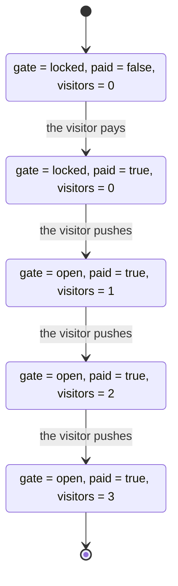

A model is most useful in review. The reviewer reads the rules as sentences and the statechart as a picture, and checks both against the product.

## Draw the statechart

```sh
earnest chart src/turnstile.model.ts --model Turnstile
```

The command prints a Mermaid statechart. GitHub draws it in a pull request body or a comment.



A chart draws at most 20 arrows. Set `--max-arrows` to change that.

## Write a report

```sh
earnest report --base origin/main
```

The report is Markdown for a pull request body. It has each model's result, its chart and the path of each broken rule. With `--base`, it also lists each rule that the branch added, removed or changed since that commit, so a reviewer sees when a rule was weakened.

## Run it in CI

`earnest verify` needs no network, no Java and no setup. It exits 0 when every model passes, and 1 when a rule breaks, a model is stuck, a model is unfinished or a file is unreadable.

```yaml title=".github/workflows/models.yml"
name: models
on: pull_request
jobs:
  verify:
    runs-on: ubuntu-latest
    steps:
      - uses: actions/checkout@v4
      - run: curl -fsSL https://raw.githubusercontent.com/cpeaustriajc/earnest/main/install.sh | sh
      - run: echo "$HOME/.local/bin" >> "$GITHUB_PATH"
      - run: earnest verify
```
