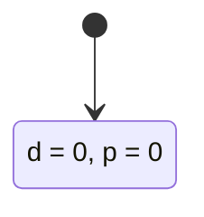

# Check of `2c8d1e0` (`perf/lone-parts`): a lone thread with a handle takes a wide level in parts

Checked commit: `2c8d1e0`, the tip of `perf/lone-parts` (four commits on `4c25766`). Reference for
"same answers": a build of `53d8497`. Toolchain: `RUSTUP_TOOLCHAIN=1.100.0` (rustc 1.100.0) for every
build and test. Linux, 4 CPUs. Both binaries came from `cargo build --release --locked -p earnest-cli`
in a `git worktree` of each commit. The tools came from a worktree of `origin/measure/tools` (`d6894fa`).
No source of the checker was changed on any branch. Every break was made on a throwaway copy of the
`2c8d1e0` tree (`git archive` into a fresh folder).

## Summary

| Step | Command | Result | As expected? |
| --- | --- | --- | --- |
| 1 | `sweep.py big4.model.ts` | 1,200 runs, 0 differences, shortest reference output 232 characters | yes |
| 1 | `sweep.py l1.model.ts` | 656 runs, 0 differences, shortest reference output 203 characters | yes |
| 1 | `sweep.py c1.model.ts` | 792 runs, 0 differences, shortest reference output 203 characters | yes |
| 2 | break `hold_after_swap_plain`, `cargo test --locked -p earnest_check --lib explore::workers` | patch applies; 1 test fails (`a_part_is_not_taken_once_the_kept_rows_outgrow_what_fits`) | yes |
| 2 | break `through_dropped`, `cargo test --locked -p earnest_check --test explore a_time_stop_in_the_last_pass` | patch applies; 1 test fails (`a_time_stop_in_the_last_pass_keeps_every_state_judged_before_it_on_every_worker_count`) | yes |
| 2 | break `merge_skips_a_task_on_ten_threads`, `cargo test --locked --no-fail-fast -p earnest_check` | patch applies; 1 test fails (`a_level_with_enough_new_states_to_merge_on_every_worker_gives_the_same_outcome_on_every_crew`) | yes |
| 3 | Break A, `cargo test --locked --no-fail-fast -p earnest_check` | 16 tests fail, including both of the required ones | yes: both required tests fail; 14 more also fail (the request did not say only those two; see finding 2) |
| 3 | Break B, `cargo test --locked --no-fail-fast -p earnest_check` | **no test fails** (143 passed) | **no: finding** |
| 3 | Break B, wider form (extra, not a replacement) | only `a_time_stop_in_a_later_round_of_a_level_a_lone_thread_takes_in_parts_leaves_nothing_behind` fails | matches what B was expected to give |
| 4 | `cargo fmt --check` | exit 0 | yes |
| 4 | `cargo clippy --all-targets --locked -- -D warnings` | exit 0 | yes |
| 4 | `cargo test --locked` | first run: 1 failure (`r01_every_typescript_model_passes_the_strict_type_checker`) because `bun install` had not run in the fresh worktree. After `bun install --frozen-lockfile`: **1,435 passed, 0 failed, 0 ignored**, exit 0 | yes, once the JS dependencies are installed |
| extra | `just check` (with 1.100.0) | exit 0 | yes |

## Findings

1. **Break B, as worded, fails no test.** The edit records the marks of the round that the time stop
   ends, and only for a level the lone thread takes in parts. A probe showed the path is reached once.
   That happens in the lone crew with a handle and no graph, in the round `75404..100000` of the
   100,000-state level. That round holds no stuck state (`stuck 0`). The stuck start state `n = 5`, whose
   mark would become a finding, was judged in an earlier round of the level. Its mark waits in the
   level's `Judged`, and `level()` drops that through `undo_level` on a time stop. So keeping only the
   stopped round's marks leaves the outcome unchanged. `a_time_stop_in_a_later_round_of_a_level_a_lone_thread_takes_in_parts_leaves_nothing_behind`
   does not catch it: the test sees a stuck state only if it lies in the round the stop ends. Whether that
   gap matters is for the author to decide. The break was not adjusted. Separately, a wider form was run
   for information: it keeps every mark of the level gathered so far, earlier rounds and the stopped
   round. It fails exactly the required test and no other.
2. **Break A fails 14 tests beyond the two required ones.** The two required tests fail. The others are
   listed below. Some are same-outcome tests across crews that run a lone thread with a handle on a level
   of 16,384 states or more. Not all of them are: the break's gate is "one thread ran every part"
   (`peak == 1`), so it also fires when a crew with idle helpers or several own threads ends up running
   every part of a level on a single thread. The 2,000-state test, below the lone size, must fail through
   that case. So the extra failures show the gate is wider than the lone path alone. They do not point to
   a problem in the change.
3. The first `cargo test --locked` run failed only for lack of `bun install` (setup of the fresh
   worktree, not the commit). The default `stable` toolchain here (1.97.0) cannot build the workspace
   (`map_or_default` is unstable there), which is why every step used 1.100.0.
4. The shortest reference outputs, 203 and 232 characters, are real reports and not errors. For example,
   `earnest report --max-arrows 100000 --max-states 1 l1.model.ts` on the `53d8497` build exits 0 with an
   "unfinished · 1 states so far" report and its state diagram (raw output below).

## Break diffs (against the `2c8d1e0` tree)

### Break A: the lone thread drops the last part of a level it takes in parts

When only one thread ran the level (`peak == 1`) and every part was taken, the last part is popped. The
level still ends `Done`, so its states are lost.

```diff
diff --git a/crates/earnest_check/src/explore/workers.rs b/crates/earnest_check/src/explore/workers.rs
index 26a7b98..70c4426 100644
--- a/crates/earnest_check/src/explore/workers.rs
+++ b/crates/earnest_check/src/explore/workers.rs
@@ -197,10 +197,14 @@ impl Search<'_> {
                     Round::RestFrom(frontier.start.saturating_add(*cut))
                 })
         };
+        let workers = shared.peak.into_inner();
+        if workers == 1 && taken.len() == parts {
+            taken.pop();
+        }
         Some(Expansion {
             parts: taken,
             end,
-            workers: shared.peak.into_inner(),
+            workers,
         })
     }
```

### Break B: when a time stop ends a round of a level, the marks of that round are kept instead of dropped

On a time stop (`undone`) in a round that one thread ran, the marks of that round's parts are recorded
instead of thrown away with the parts.

```diff
diff --git a/crates/earnest_check/src/explore.rs b/crates/earnest_check/src/explore.rs
index 17a4697..b8fa55b 100644
--- a/crates/earnest_check/src/explore.rs
+++ b/crates/earnest_check/src/explore.rs
@@ -286,6 +286,11 @@ impl Search<'_> {
         };
         let undone = ran.end == Round::Stopped && asked == Asked::Everything;
         if ran.end == Round::RestAlone || undone {
+            if undone && expansion.workers == 1 {
+                for part in &expansion.parts {
+                    self.record_all(&part.marks, part.first.saturating_add(part.expanded));
+                }
+            }
             return Some(ran);
         }
         let before = self.store.len();
```

### Break B, wider form (extra, for information)

The marks of the stopped round go into the level's `Judged`. Then every mark the level gathered is
recorded, the earlier rounds included.

```diff
diff --git a/crates/earnest_check/src/explore.rs b/crates/earnest_check/src/explore.rs
index 17a4697..85de578 100644
--- a/crates/earnest_check/src/explore.rs
+++ b/crates/earnest_check/src/explore.rs
@@ -286,6 +286,12 @@ impl Search<'_> {
         };
         let undone = ran.end == Round::Stopped && asked == Asked::Everything;
         if ran.end == Round::RestAlone || undone {
+            if undone && expansion.workers == 1 {
+                for part in expansion.parts {
+                    judged.add(part.marks, part.first.saturating_add(part.expanded));
+                }
+                self.record_all(&judged.marks, judged.through);
+            }
             return Some(ran);
         }
         let before = self.store.len();
```

## Old breaks: `breaks/run.sh` ported to Linux

`rsync` is not installed here, so each copy comes from `git archive` of the `2c8d1e0` worktree. Paths
are placeholders.

```bash
#!/bin/bash
B=<work>/breaks
T=<tip>
export RUSTUP_TOOLCHAIN=1.100.0
mk() {
  rm -rf "$B/src-$1"; mkdir -p "$B/src-$1"
  git -C "$T" archive HEAD | tar -x -C "$B/src-$1"
  python3 -I "$B/patch.py" "$1" "$B/src-$1" && echo "prepared break $1 on $(git -C "$T" rev-parse --short HEAD)"
}
show='^test .*FAILED|left:|right:|test result|failed:$|^    [a-z_:]+$'
mk hold_after_swap_plain
(cd "$B/src-hold_after_swap_plain" && CARGO_TARGET_DIR=$B/target cargo test --locked -p earnest_check --lib explore::workers 2>&1 | grep -E "$show")
mk through_dropped
(cd "$B/src-through_dropped" && CARGO_TARGET_DIR=$B/target cargo test --locked -p earnest_check --test explore a_time_stop_in_the_last_pass 2>&1 | grep -E "$show")
mk merge_skips_a_task_on_ten_threads
(cd "$B/src-merge_skips_a_task_on_ten_threads" && CARGO_TARGET_DIR=$B/target cargo test --locked --no-fail-fast -p earnest_check 2>&1 | grep -E "$show")
```

All three patches in `breaks/patch.py` still apply to `2c8d1e0` unchanged (no `assert` fired).

# Raw outputs

## Step 1: sweeps

```
$ TIP=<2c8d1e0>/target/release/earnest REF=<53d8497>/target/release/earnest python3 measure/tools/scripts/linux/sweep.py big4.model.ts
{"model": "big4.model.ts", "levels": 14, "limits": 150, "runs": 1200, "differences": 0, "first": [], "shortest reference output": 232}

real	8m23.437s
user	22m20.063s
sys	0m15.515s

$ TIP=<2c8d1e0>/target/release/earnest REF=<53d8497>/target/release/earnest python3 measure/tools/scripts/linux/sweep.py l1.model.ts
{"model": "l1.model.ts", "levels": 10, "limits": 82, "runs": 656, "differences": 0, "first": [], "shortest reference output": 203}

real	1m47.391s
user	5m35.763s
sys	0m4.291s

$ TIP=<2c8d1e0>/target/release/earnest REF=<53d8497>/target/release/earnest python3 measure/tools/scripts/linux/sweep.py c1.model.ts
{"model": "c1.model.ts", "levels": 11, "limits": 99, "runs": 792, "differences": 0, "first": [], "shortest reference output": 203}

real	0m25.019s
user	1m18.346s
sys	0m4.206s
```

The reference build on a short limit:

```
$ <53d8497>/target/release/earnest report --max-arrows 100000 --max-states 1 l1.model.ts
## G

**unfinished** · G · 1 states so far · state limit of 1 · `l1.model.ts`


exit 0
```

## Step 2: old breaks (lines kept by the `show` filter of `run.sh`)

```
$ cargo test --locked -p earnest_check --lib explore::workers   # break hold_after_swap_plain
test explore::workers::tests::a_part_is_not_taken_once_the_kept_rows_outgrow_what_fits ... FAILED
  left: 2
 right: 1
    explore::workers::tests::a_part_is_not_taken_once_the_kept_rows_outgrow_what_fits
test result: FAILED. 4 passed; 1 failed; 0 ignored; 0 measured; 26 filtered out; finished in 0.09s
```

```
$ cargo test --locked -p earnest_check --test explore a_time_stop_in_the_last_pass   # break through_dropped
test limits::a_time_stop_in_the_last_pass_keeps_every_state_judged_before_it_on_every_worker_count ... FAILED
  left: 0
 right: 2599
    limits::a_time_stop_in_the_last_pass_keeps_every_state_judged_before_it_on_every_worker_count
test result: FAILED. 0 passed; 1 failed; 0 ignored; 0 measured; 111 filtered out; finished in 2.09s
```

```
$ cargo test --locked --no-fail-fast -p earnest_check   # break merge_skips_a_task_on_ten_threads
test result: ok. 31 passed; 0 failed; 0 ignored; 0 measured; 0 filtered out; finished in 0.00s
test limits::a_level_with_enough_new_states_to_merge_on_every_worker_gives_the_same_outcome_on_every_crew ... FAILED
  left: Outcome { status: Fail, states: 88649, rules: [RuleOutcome { id: "not1234", says: "not1234 always", verdict: Broken, path: Some(Path { start: [Named { name: "n", value: Shown { text: "1234", json: Number(1234) } }, Named { name: "flipped", value: Shown { text: "false", json: Bool(false) } }], steps: [Step { action: "flip", label: "does flip", input: [], changes: [Change { field: "flipped", before: Shown { text: "false", json: Bool(false) }, after: Shown { text: "true", json: Bool(true) } }], state: [Named { name: "n", value: Shown { text: "1234", json: Number(1234) } }, Named { name: "flipped", value: Shown { text: "true", json: Bool(true) } }] }] }) }], findings: [], reason: None, computes_beyond_32_bits: false, graph: None }
 right: Outcome { status: Fail, states: 90000, rules: [RuleOutcome { id: "not1234", says: "not1234 always", verdict: Broken, path: Some(Path { start: [Named { name: "n", value: Shown { text: "1234", json: Number(1234) } }, Named { name: "flipped", value: Shown { text: "false", json: Bool(false) } }], steps: [Step { action: "flip", label: "does flip", input: [], changes: [Change { field: "flipped", before: Shown { text: "false", json: Bool(false) }, after: Shown { text: "true", json: Bool(true) } }], state: [Named { name: "n", value: Shown { text: "1234", json: Number(1234) } }, Named { name: "flipped", value: Shown { text: "true", json: Bool(true) } }] }] }) }], findings: [], reason: None, computes_beyond_32_bits: false, graph: None }
    limits::a_level_with_enough_new_states_to_merge_on_every_worker_gives_the_same_outcome_on_every_crew
test result: FAILED. 111 passed; 1 failed; 0 ignored; 0 measured; 0 filtered out; finished in 37.64s
test result: ok. 0 passed; 0 failed; 0 ignored; 0 measured; 0 filtered out; finished in 0.00s
error: 1 target failed:
```

## Step 3: Break A

```
$ cargo test --locked --no-fail-fast -p earnest_check
test result: ok. 31 passed; 0 failed; 0 ignored; 0 measured; 0 filtered out; finished in 0.00s
test limits::a_level_of_two_thousand_states_gives_the_same_outcome_on_one_thread_and_on_four ... FAILED
test lending::threads_that_become_idle_while_a_level_runs_change_nothing_and_come_back ... FAILED
test limits::a_search_with_many_wide_levels_gives_the_same_outcome_on_one_thread_and_on_four ... FAILED
test limits::a_state_limit_at_the_end_of_a_level_gives_the_same_outcome_on_every_worker_count ... FAILED
test limits::a_state_limit_inside_a_level_gives_the_same_outcome_on_every_worker_count ... FAILED
test limits::a_state_limit_one_above_the_states_of_a_wide_level_of_known_steps_is_never_reached ... FAILED
test limits::a_lone_thread_with_a_handle_matches_row_by_row_at_every_state_limit_near_a_wide_level ... FAILED
test limits::a_state_limit_one_above_the_states_of_a_model_gives_the_same_outcome_on_every_worker_count ... FAILED
test limits::a_level_with_enough_new_states_to_merge_on_every_worker_gives_the_same_outcome_on_every_crew ... FAILED
test limits::every_state_of_a_level_held_back_at_a_limit_never_reached_is_expanded ... FAILED
test storage::a_limit_above_four_billion_states_changes_nothing ... FAILED
test storage::many_workers_find_the_same_paths_through_states_met_from_several_parts ... FAILED
test storage::workers_find_the_same_states_when_a_value_has_no_code_yet ... FAILED
test storage::many_workers_stop_at_the_same_state_limit ... FAILED
test storage::workers_keep_rows_too_wide_for_one_word_the_same_as_one_thread ... FAILED
test storage::workers_keep_the_states_that_leave_their_domain ... FAILED
test result: FAILED. 96 passed; 16 failed; 0 ignored; 0 measured; 0 filtered out; finished in 33.97s
error: test failed, to rerun pass `-p earnest_check --test explore`
test result: ok. 0 passed; 0 failed; 0 ignored; 0 measured; 0 filtered out; finished in 0.00s
error: 1 target failed:
```

The failing tests, from the `failures:` list:

```
    lending::threads_that_become_idle_while_a_level_runs_change_nothing_and_come_back
    limits::a_level_of_two_thousand_states_gives_the_same_outcome_on_one_thread_and_on_four
    limits::a_level_with_enough_new_states_to_merge_on_every_worker_gives_the_same_outcome_on_every_crew
    limits::a_lone_thread_with_a_handle_matches_row_by_row_at_every_state_limit_near_a_wide_level
    limits::a_search_with_many_wide_levels_gives_the_same_outcome_on_one_thread_and_on_four
    limits::a_state_limit_at_the_end_of_a_level_gives_the_same_outcome_on_every_worker_count
    limits::a_state_limit_inside_a_level_gives_the_same_outcome_on_every_worker_count
    limits::a_state_limit_one_above_the_states_of_a_model_gives_the_same_outcome_on_every_worker_count
    limits::a_state_limit_one_above_the_states_of_a_wide_level_of_known_steps_is_never_reached
    limits::every_state_of_a_level_held_back_at_a_limit_never_reached_is_expanded
    storage::a_limit_above_four_billion_states_changes_nothing
    storage::many_workers_find_the_same_paths_through_states_met_from_several_parts
    storage::many_workers_stop_at_the_same_state_limit
    storage::workers_find_the_same_states_when_a_value_has_no_code_yet
    storage::workers_keep_rows_too_wide_for_one_word_the_same_as_one_thread
    storage::workers_keep_the_states_that_leave_their_domain
```

## Step 3: Break B

```
$ cargo test --locked --no-fail-fast -p earnest_check
     Running unittests src/lib.rs (<breaks>/target-B/debug/build/earnest_check/3bc94a9591c67248/out/earnest_check-3bc94a9591c67248)
test result: ok. 31 passed; 0 failed; 0 ignored; 0 measured; 0 filtered out; finished in 0.00s
     Running tests/explore/main.rs (<breaks>/target-B/debug/build/earnest_check/4f5063bfdf4a359c/out/explore-4f5063bfdf4a359c)
test result: ok. 112 passed; 0 failed; 0 ignored; 0 measured; 0 filtered out; finished in 38.34s
   Doc-tests earnest_check
test result: ok. 0 passed; 0 failed; 0 ignored; 0 measured; 0 filtered out; finished in 0.00s
exit 0
```

The probe (a throwaway copy of the Break B tree with one `eprintln!` in the new branch), on the lone test:

```
$ cargo test --locked -p earnest_check --test explore a_time_stop_in_a_later_round_of_a_level_a_lone_thread_takes_in_parts -- --nocapture
PROBE undone lone round 75404..100000 parts 64 stuck 0 judged_marks 1 judged_stuck 1
test result: ok. 1 passed; 0 failed; 0 ignored; 0 measured; 111 filtered out; finished in 9.38s
```

## Step 3: Break B, wider form

```
$ cargo test --locked --no-fail-fast -p earnest_check
test result: ok. 31 passed; 0 failed; 0 ignored; 0 measured; 0 filtered out; finished in 0.00s
test limits::a_time_stop_in_a_later_round_of_a_level_a_lone_thread_takes_in_parts_leaves_nothing_behind ... FAILED
test result: FAILED. 111 passed; 1 failed; 0 ignored; 0 measured; 0 filtered out; finished in 41.36s
error: test failed, to rerun pass `-p earnest_check --test explore`
test result: ok. 0 passed; 0 failed; 0 ignored; 0 measured; 0 filtered out; finished in 0.00s
error: 1 target failed:
```

## Step 4: the unbroken `2c8d1e0` tree

```
$ cargo fmt --check
exit: 0
```

```
$ cargo clippy --all-targets --locked -- -D warnings
    Finished `dev` profile [unoptimized + debuginfo] target(s) in 41.73s
exit: 0
```

The first `cargo test --locked`, in the fresh worktree before `bun install`:

```
$ cargo test --locked
test result: ok. 4 passed; 0 failed; 0 ignored; 0 measured; 0 filtered out; finished in 0.00s
test result: ok. 56 passed; 0 failed; 0 ignored; 0 measured; 0 filtered out; finished in 0.11s
test result: ok. 131 passed; 0 failed; 0 ignored; 0 measured; 0 filtered out; finished in 0.31s
test results::r15_one_result_line_per_model_with_its_state_count_and_time ... ok
test results::r12_one_worker_and_four_workers_give_the_same_results ... ok
test results::r16_the_same_results_come_out_as_json ... ok
test results::r17_a_path_among_many_of_the_same_length_is_the_same_on_every_run ... ok
test results::r15_the_exit_code_is_zero_only_when_every_model_passes ... ok
test results::r12_a_large_model_has_the_same_count_on_every_number_of_workers ... ok
test results::r16_json_and_text_agree_on_every_model ... ok
test results::r17_two_runs_give_the_same_json_in_the_same_order ... ok
test results::r17_two_runs_print_the_same_path_for_each_broken_rule ... ok
test typescript::r01_every_typescript_model_passes_the_strict_type_checker ... FAILED
test result: FAILED. 73 passed; 1 failed; 0 ignored; 0 measured; 0 filtered out; finished in 1.99s
error: test failed, to rerun pass `-p earnest-cli --test behavior`
---- typescript::r01_every_typescript_model_passes_the_strict_type_checker stdout ----
`bun install` has put `tsrs` in `packages/model/node_modules/.bin`: Os { code: 2, kind: NotFound, message: "No such file or directory" }
exit 101
```

After `bun install --frozen-lockfile` (44 packages):

```
$ cargo test --locked
     Running unittests src/lib.rs (target/debug/build/earnest/fca3bed7d264832d/out/earnest-fca3bed7d264832d)
test result: ok. 4 passed; 0 failed; 0 ignored; 0 measured; 0 filtered out; finished in 0.00s
     Running tests/model/main.rs (target/debug/build/earnest/d8f52717df430152/out/model-d8f52717df430152)
test result: ok. 56 passed; 0 failed; 0 ignored; 0 measured; 0 filtered out; finished in 0.12s
     Running unittests src/main.rs (target/debug/build/earnest-cli/d87567e2f618125f/out/earnest-d87567e2f618125f)
test result: ok. 131 passed; 0 failed; 0 ignored; 0 measured; 0 filtered out; finished in 0.30s
     Running tests/behavior/main.rs (target/debug/build/earnest-cli/4bb6449d850b9d23/out/behavior-4bb6449d850b9d23)
test results::r12_one_worker_and_four_workers_give_the_same_results ... ok
test results::r15_one_result_line_per_model_with_its_state_count_and_time ... ok
test results::r16_the_same_results_come_out_as_json ... ok
test results::r17_a_path_among_many_of_the_same_length_is_the_same_on_every_run ... ok
test results::r15_the_exit_code_is_zero_only_when_every_model_passes ... ok
test results::r12_a_large_model_has_the_same_count_on_every_number_of_workers ... ok
test results::r16_json_and_text_agree_on_every_model ... ok
test results::r17_two_runs_give_the_same_json_in_the_same_order ... ok
test results::r17_two_runs_print_the_same_path_for_each_broken_rule ... ok
test result: ok. 74 passed; 0 failed; 0 ignored; 0 measured; 0 filtered out; finished in 1.96s
     Running tests/dogfood.rs (target/debug/build/earnest-cli/88f84c2a5c8acc32/out/dogfood-88f84c2a5c8acc32)
test result: ok. 12 passed; 0 failed; 0 ignored; 0 measured; 0 filtered out; finished in 0.06s
     Running tests/no_model.rs (target/debug/build/earnest-cli/dd5f744caa89443b/out/no_model-dd5f744caa89443b)
test result: ok. 6 passed; 0 failed; 0 ignored; 0 measured; 0 filtered out; finished in 0.02s
     Running tests/reference/main.rs (target/debug/build/earnest-cli/a635bab36b33e04c/out/reference-a635bab36b33e04c)
test result: ok. 2 passed; 0 failed; 0 ignored; 0 measured; 0 filtered out; finished in 7.85s
     Running tests/rust_agreement/main.rs (target/debug/build/earnest-cli/b8d1c085772a2110/out/rust_agreement-b8d1c085772a2110)
test result: ok. 7 passed; 0 failed; 0 ignored; 0 measured; 0 filtered out; finished in 6.00s
     Running tests/rust_models/main.rs (target/debug/build/earnest-cli/cdf39b2147280c71/out/rust_models-cdf39b2147280c71)
test result: ok. 15 passed; 0 failed; 0 ignored; 0 measured; 0 filtered out; finished in 5.66s
     Running tests/test_files.rs (target/debug/build/earnest-cli/45a3bc0b4a81b2db/out/test_files-45a3bc0b4a81b2db)
test result: ok. 5 passed; 0 failed; 0 ignored; 0 measured; 0 filtered out; finished in 0.01s
     Running tests/tla_rs.rs (target/debug/build/earnest-cli/cff33b5dfdea1258/out/tla_rs-cff33b5dfdea1258)
test result: ok. 6 passed; 0 failed; 0 ignored; 0 measured; 0 filtered out; finished in 0.02s
     Running tests/walk_order/main.rs (target/debug/build/earnest-cli/64de473a57428f21/out/walk_order-64de473a57428f21)
test result: ok. 5 passed; 0 failed; 0 ignored; 0 measured; 0 filtered out; finished in 2.51s
     Running tests/workspace/main.rs (target/debug/build/earnest-cli/f2e14aa9c131afd5/out/workspace-f2e14aa9c131afd5)
test result: ok. 5 passed; 0 failed; 0 ignored; 0 measured; 0 filtered out; finished in 0.02s
     Running unittests src/lib.rs (target/debug/build/earnest_ast/f376442e40bdbe30/out/earnest_ast-f376442e40bdbe30)
test result: ok. 12 passed; 0 failed; 0 ignored; 0 measured; 0 filtered out; finished in 0.00s
     Running tests/tree.rs (target/debug/build/earnest_ast/04d887e6a1d5a9b0/out/tree-04d887e6a1d5a9b0)
test result: ok. 7 passed; 0 failed; 0 ignored; 0 measured; 0 filtered out; finished in 0.00s
     Running unittests src/main.rs (target/debug/build/earnest_benchmark/6fd91508fece17a9/out/benchmark-6fd91508fece17a9)
test result: ok. 25 passed; 0 failed; 0 ignored; 0 measured; 0 filtered out; finished in 0.00s
     Running unittests src/lib.rs (target/debug/build/earnest_break_it/fb3329c489e03504/out/earnest_break_it-fb3329c489e03504)
test result: ok. 0 passed; 0 failed; 0 ignored; 0 measured; 0 filtered out; finished in 0.00s
     Running tests/break_it/main.rs (target/debug/build/earnest_break_it/652ec030ef53f2c2/out/break_it-652ec030ef53f2c2)
test result: ok. 78 passed; 0 failed; 0 ignored; 0 measured; 0 filtered out; finished in 23.56s
     Running unittests src/lib.rs (target/debug/build/earnest_chart/3a1ca2b2b8492fa6/out/earnest_chart-3a1ca2b2b8492fa6)
test result: ok. 7 passed; 0 failed; 0 ignored; 0 measured; 0 filtered out; finished in 0.00s
     Running tests/writer/main.rs (target/debug/build/earnest_chart/0dcd6928920db35b/out/writer-0dcd6928920db35b)
test result: ok. 48 passed; 0 failed; 0 ignored; 0 measured; 0 filtered out; finished in 2.51s
     Running unittests src/lib.rs (target/debug/build/earnest_check/471ba9dc74c08d1e/out/earnest_check-471ba9dc74c08d1e)
test result: ok. 31 passed; 0 failed; 0 ignored; 0 measured; 0 filtered out; finished in 0.00s
     Running tests/explore/main.rs (target/debug/build/earnest_check/2de020a0441ac4b7/out/explore-2de020a0441ac4b7)
test result: ok. 112 passed; 0 failed; 0 ignored; 0 measured; 0 filtered out; finished in 39.63s
     Running unittests src/lib.rs (target/debug/build/earnest_diagnostics/c8a31a92ec423657/out/earnest_diagnostics-c8a31a92ec423657)
test result: ok. 0 passed; 0 failed; 0 ignored; 0 measured; 0 filtered out; finished in 0.00s
     Running tests/problem.rs (target/debug/build/earnest_diagnostics/83c1cd848a04a233/out/problem-83c1cd848a04a233)
test result: ok. 5 passed; 0 failed; 0 ignored; 0 measured; 0 filtered out; finished in 0.00s
     Running unittests src/lib.rs (target/debug/build/earnest_ir/1ee6875b3dd318fe/out/earnest_ir-1ee6875b3dd318fe)
test result: ok. 0 passed; 0 failed; 0 ignored; 0 measured; 0 filtered out; finished in 0.00s
     Running tests/eval.rs (target/debug/build/earnest_ir/688ad96c9f98143e/out/eval-688ad96c9f98143e)
test result: ok. 71 passed; 0 failed; 0 ignored; 0 measured; 0 filtered out; finished in 34.11s
     Running tests/told.rs (target/debug/build/earnest_ir/84c9697324c11db9/out/told-84c9697324c11db9)
test result: ok. 16 passed; 0 failed; 0 ignored; 0 measured; 0 filtered out; finished in 1.14s
     Running unittests src/lib.rs (target/debug/build/earnest_macros/006e1231c13102a1/out/earnest_macros-006e1231c13102a1)
test result: ok. 23 passed; 0 failed; 0 ignored; 0 measured; 0 filtered out; finished in 0.00s
     Running unittests src/lib.rs (target/debug/build/earnest_models/2436728acbd89832/out/earnest_models-2436728acbd89832)
test result: ok. 3 passed; 0 failed; 0 ignored; 0 measured; 0 filtered out; finished in 2.86s
     Running tests/verify.rs (target/debug/build/earnest_models/dffb80ab3967b1ac/out/verify-dffb80ab3967b1ac)
test result: ok. 3 passed; 0 failed; 0 ignored; 0 measured; 0 filtered out; finished in 2.08s
     Running unittests src/lib.rs (target/debug/build/earnest_rs/5a219c9ccdfd6a3d/out/earnest_rs-5a219c9ccdfd6a3d)
test result: ok. 8 passed; 0 failed; 0 ignored; 0 measured; 0 filtered out; finished in 0.00s
     Running tests/read/main.rs (target/debug/build/earnest_rs/2dabff59fbb649cd/out/read-2dabff59fbb649cd)
test result: ok. 100 passed; 0 failed; 0 ignored; 0 measured; 0 filtered out; finished in 0.58s
     Running tests/rustc/main.rs (target/debug/build/earnest_rs/195df987a21ea548/out/rustc-195df987a21ea548)
test result: ok. 4 passed; 0 failed; 0 ignored; 0 measured; 0 filtered out; finished in 14.11s
     Running unittests src/lib.rs (target/debug/build/earnest_semantic/e6bad382561176fd/out/earnest_semantic-e6bad382561176fd)
test result: ok. 16 passed; 0 failed; 0 ignored; 0 measured; 0 filtered out; finished in 0.00s
     Running tests/lower/main.rs (target/debug/build/earnest_semantic/116318e03cbf2c74/out/lower-116318e03cbf2c74)
test result: ok. 178 passed; 0 failed; 0 ignored; 0 measured; 0 filtered out; finished in 0.05s
     Running unittests src/lib.rs (target/debug/build/earnest_tla/94118d11af1ab99c/out/earnest_tla-94118d11af1ab99c)
test result: ok. 37 passed; 0 failed; 0 ignored; 0 measured; 0 filtered out; finished in 0.00s
     Running tests/write/main.rs (target/debug/build/earnest_tla/95599f903df83c6f/out/write-95599f903df83c6f)
test result: ok. 135 passed; 0 failed; 0 ignored; 0 measured; 0 filtered out; finished in 1.64s
     Running unittests src/lib.rs (target/debug/build/earnest_ts/3acb097e34494da8/out/earnest_ts-3acb097e34494da8)
test result: ok. 128 passed; 0 failed; 0 ignored; 0 measured; 0 filtered out; finished in 0.07s
     Running tests/conformance/main.rs (target/debug/build/earnest_ts/4b2470aaad002807/out/conformance-4b2470aaad002807)
test result: ok. 11 passed; 0 failed; 0 ignored; 0 measured; 0 filtered out; finished in 1.00s
     Running unittests src/lib.rs (target/debug/build/earnest_value/0ab575937b20712a/out/earnest_value-0ab575937b20712a)
test result: ok. 9 passed; 0 failed; 0 ignored; 0 measured; 0 filtered out; finished in 0.00s
     Running tests/domain.rs (target/debug/build/earnest_value/320137f176da9535/out/domain-320137f176da9535)
test result: ok. 17 passed; 0 failed; 0 ignored; 0 measured; 0 filtered out; finished in 0.09s
     Running tests/symbols.rs (target/debug/build/earnest_value/64c5e3878ab4a0a6/out/symbols-64c5e3878ab4a0a6)
test result: ok. 14 passed; 0 failed; 0 ignored; 0 measured; 0 filtered out; finished in 0.00s
   Doc-tests earnest
test result: ok. 9 passed; 0 failed; 0 ignored; 0 measured; 0 filtered out; finished in 0.32s
   Doc-tests earnest_ast
test result: ok. 0 passed; 0 failed; 0 ignored; 0 measured; 0 filtered out; finished in 0.00s
   Doc-tests earnest_break_it
test result: ok. 0 passed; 0 failed; 0 ignored; 0 measured; 0 filtered out; finished in 0.00s
   Doc-tests earnest_chart
test result: ok. 0 passed; 0 failed; 0 ignored; 0 measured; 0 filtered out; finished in 0.00s
   Doc-tests earnest_check
test result: ok. 0 passed; 0 failed; 0 ignored; 0 measured; 0 filtered out; finished in 0.00s
   Doc-tests earnest_diagnostics
test result: ok. 0 passed; 0 failed; 0 ignored; 0 measured; 0 filtered out; finished in 0.00s
   Doc-tests earnest_ir
test result: ok. 0 passed; 0 failed; 0 ignored; 0 measured; 0 filtered out; finished in 0.00s
   Doc-tests earnest_macros
test result: ok. 0 passed; 0 failed; 0 ignored; 0 measured; 0 filtered out; finished in 0.00s
   Doc-tests earnest_models
test result: ok. 0 passed; 0 failed; 0 ignored; 0 measured; 0 filtered out; finished in 0.00s
   Doc-tests earnest_rs
test result: ok. 0 passed; 0 failed; 0 ignored; 0 measured; 0 filtered out; finished in 0.00s
   Doc-tests earnest_semantic
test result: ok. 0 passed; 0 failed; 0 ignored; 0 measured; 0 filtered out; finished in 0.00s
   Doc-tests earnest_tla
test result: ok. 0 passed; 0 failed; 0 ignored; 0 measured; 0 filtered out; finished in 0.00s
   Doc-tests earnest_ts
test result: ok. 0 passed; 0 failed; 0 ignored; 0 measured; 0 filtered out; finished in 0.00s
   Doc-tests earnest_value
test result: ok. 0 passed; 0 failed; 0 ignored; 0 measured; 0 filtered out; finished in 0.00s
exit 0
total: 1435 passed, 0 failed, 0 ignored
```

```
$ just check
target/release/earnest verify --no-cache tasks/models
pass        Cache  394 states  656 ms
pass        Outcome  7222 states  77 ms
pass        Pool  35612 states  233 ms
3 models: 3 pass, 0 fail, 0 unfinished
exit 0
```
